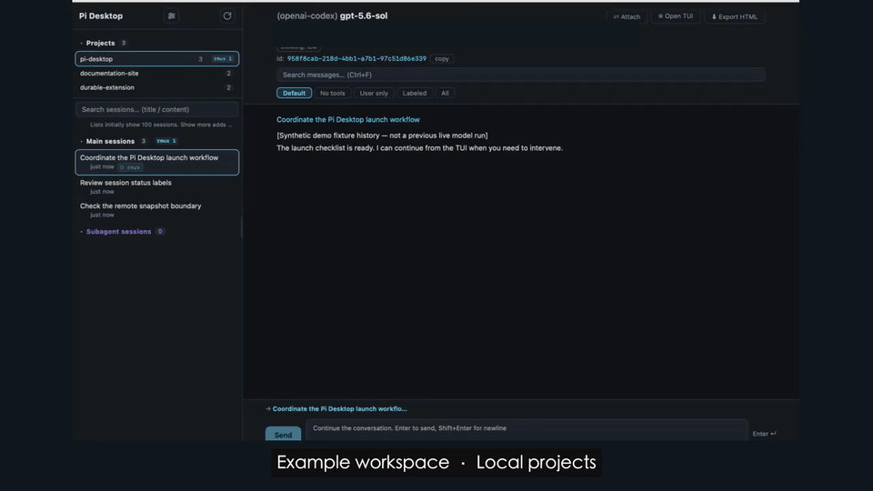

# Pi Desktop

[中文](README.md) · [Development notes](docs/development.md)

A desktop companion to the Pi TUI: attach for in-depth interaction; detach while the agent works and use the Desktop sidebar for an overview of projects, sessions and subagents.

## Real native walkthrough



[19-second silent MP4](docs/assets/native-workflow.en.mp4) · [PNG cover](docs/assets/native-workflow.en.png) · [Demo details and verification](docs/native-walkthrough.md)

The complete loop: **overview → attach → TUI interaction → detach → overview**. Edited recordings of the real native UI and real Pi TUI / RMUX / model execution—not an SVG concept animation. The GIF is silent.

The workspace and seed history are synthetic examples. This demonstrates local multi-project use, not live remote state. Zooms, highlights and privacy masks are editorial; the final overview is a separate take after task completion, not evidence of continued execution. The recording uses an earlier UI; the current app and notes below describe the 0.1.9 sidebar authorization icon and compact history controls.

## Try a local demo

```bash
git clone https://github.com/roshameow/pi-session-viewer.git
cd pi-session-viewer
npm ci
npm run demo
```

Open `/demo.html`. The demo renders the actual sidebar and conversation components with synthetic sessions. It never reads your session directory or calls a model. Requires Node.js 22+.

## 0.1.9 update

- Data access is a small folder-lock icon beside Config, not a main-pane toolbar.
- Local Markdown file links open through the system with the session CWD; source files use a text editor on macOS, failures are visible, and remote/preview paths never resolve to same-named local files.
- History navigation shares the search row: loaded/matched count, Latest and `⋯`; complete statistics/notices and branch navigation stay in the disclosure. Search/filter/paging behavior is unchanged.

Build, isolated regressions and local code-signature integrity checks pass. Cross-restart protected-directory authorization and all native default-app handlers remain unverified; this is not a notarized official binary release. See [Changelog](CHANGELOG.md).

## Remembered data directories

Use the small folder-lock icon beside Config in the sidebar (**Data access / 数据目录**) to choose a specific folder through the macOS file picker, remember its authorization, explicitly copy individual files and insert a copy's path into a local conversation draft. The source broker is read-only; no content is automatically sent and Full Disk Access is not requested.

This is a viewer-owned data-sharing broker, **not a filesystem allowlist or sandbox for arbitrary Pi/Python tasks**. Direct task access to original app data can still prompt, and invalid bookmarks may require reselection. Revoking a source and deleting its copies are separate actions. See [usage and privacy boundaries](docs/data-access.md).

## Compact history and local file links

The history count and Latest action sit beside search; `⋯` reveals role/file statistics, full notices and branch navigation. Search/filter/paging behavior is unchanged. Local Markdown file links use a click-only native opener with the selected session CWD; macOS source files use text-editor routing, errors are visible, and remote/preview contexts do not open local paths. See [formats and limitations](docs/local-file-links.md).

## 0.1.6 large-session details

Ordinary view/refresh downloads the latest 100 active-branch entries within a 256 KiB serialized response. Earlier-page cursors, whole-selected-branch search/filter counts and entry/branch navigation remain available. Giant records are explicit previews with cancellable original-JSONL chunk view/download, never silently truncated code/evidence. Export still reads the full session. Changed files invalidate old cursors/body references with a refresh notice; source history is never rewritten.

This bounds normal transport and retained memory, not cold indexing time or system-wide pressure from other applications.

## 0.1.5 folder switching and remote cache

Session sections initially show 100 rows with explicit show-more. Search covers all loaded sessions and off-page selection remains visible. Source/project caches reuse results while stale replies and canceled polls cannot overwrite a new selection.

A usable remote cache displays before background refresh; the UI reports cache age, phase and errors. First-time hosts still need initial sync. Cached snapshots are not live telemetry or an atomic whole-history/process snapshot. LAN latency does not eliminate cold indexing and GUI rendering cost.

## 0.1.4 list scaling and remote sources

Headers use bounded streaming reads; full-transcript legacy parent matching runs only for unmarked workers. Sidebar parent lookup is indexed. Process identity validation is batched; remote readers use only that host's captured snapshots, never desktop processes with the same PID. Caches are scoped to source, directory and snapshots.

No history is pruned and no Pi/worker is stopped. Remote cache state is not live telemetry. Multi-GB directories may still take seconds on their first cold load; cache-hit timing is not a universal cold-load guarantee.

## 0.1.2 running-indicator fix

- Yellow (busy) is a **compatibility inference from verified Pi identity and the last relevant pending transcript message** (user, assistant `toolUse` / toolCall, or toolResult), **not live SDK `isStreaming`**. Long thinking or tool execution with a verified Pi no longer loses yellow solely because JSONL has not changed for 60 seconds. A final assistant stop / error / abort does not light up an idle TUI.
- UNKNOWN identity permits only a short fresh-transcript weak fallback. An explicitly ended Pi / retained dead shell remains false; terminal presence is not busy activity.
- Match anchored `pi-subagent-task-*` process titles, not shell / tee mentions. Normal `pi_subagent_exit(exitCode=0)` metadata no longer hides preceding `agent_settled`.
- Remote PID age guards use captured source-host time, or fixed snapshot mtime for legacy captures; sync filtering includes `pi-subagent` titles. Remote state remains **the latest manually synced snapshot, not live status**.

This inference does not fully guarantee auto-retry, compaction, oversized / truncated JSON, or SSH-degradation behavior. Pure regressions and one local read-only inventory are not GUI / remote end-to-end acceptance.

## 0.1.1 compatibility update

- Inventory native `.pi/mcp.json` and legacy adapter `.mcp.json`, including source and exposure; this is not live connection status or project trust.
- Preserve native MCP / codemode / tool_search names, match nested and parallel results by `toolCallId`, and show full arguments when expanded.
- Distinguish `ended rmux` (finished worker, retained shell), `? rmux` (unknown identity), and exited panes. Browsing no longer automatically cleans up windows or runtime files.
- Continue through Pi CLI JSON mode with the session cwd and concurrent stderr diagnostics, without overriding model, extension, or tool settings.

Regression coverage uses mocks / a fake CLI, not live MCP, RMUX, SSH, or model integration.

## Desktop setup

Source builds are available; there is no verified official binary release yet. macOS is the primary development platform. Linux and Windows have partial code paths but are not claimed as fully tested desktop targets.

Install Node.js 22+, Rust 1.88+, [Tauri prerequisites](https://v2.tauri.app/start/prerequisites/) and Pi, then run:

```bash
npm ci
npm run tauri dev
```

Install RMUX separately to use persistent terminal features. `npm run build:unsigned -- --bundles app --ci` builds only a local `.app` (no DMG) without requiring the maintainer's named signing certificate; it is not a notarized distribution. Maintainers with the existing signing identity can use `npm run tauri -- build --bundles app --ci`. Neither command installs or launches the app. See [development notes](docs/development.md) for stable signing and accessibility permissions.

## Isolated verification

```bash
npm run test:adaptation
npm run test:data-access
npm run test:local-links
npm run test:history-controls
npm run test:detail
node scripts/test-sidebar-paging.mjs
npm run build
cargo test --offline --manifest-path src-tauri/Cargo.toml running_diagnostics -- --skip live_running_inventory
cargo test --offline --manifest-path src-tauri/Cargo.toml adaptation_tests -- --test-threads=1
cargo test --offline --manifest-path src-tauri/Cargo.toml data_access_tests -- --test-threads=1
cargo test --offline --manifest-path src-tauri/Cargo.toml local_links_tests -- --test-threads=1
```

The Unix fake CLI test requires Python 3. On macOS, prefix the Rust command with `PATH="$HOME/.cargo/bin:$PATH"` to select an already-installed rustup toolchain if needed; Rust ≥1.88 is required, not dependency upgrades. Full `cargo test` includes local-data / RMUX tests and is not an isolated acceptance check.

Features include project grouping, message/tool rendering, nested subagents, terminal status, local Pi continuation, configuration browsing and HTML export.

Explicit parent UUIDs resolve worker → grandchild links using canonical paths (preferring real files over mirrors). Missing, self/cyclic or ambiguous explicit lineage stays unresolved without guessing. Sidebar main groups still show direct children; nested worker parent labels appear in the subagent section.

[Changelog](CHANGELOG.md) · [Issues](https://github.com/roshameow/pi-session-viewer/issues) · [MIT](LICENSE)
